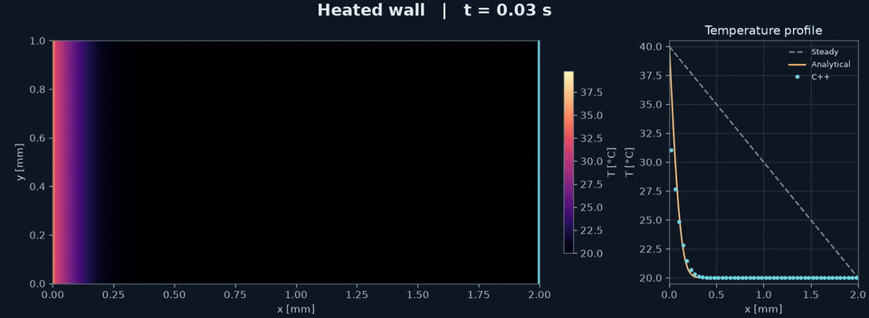
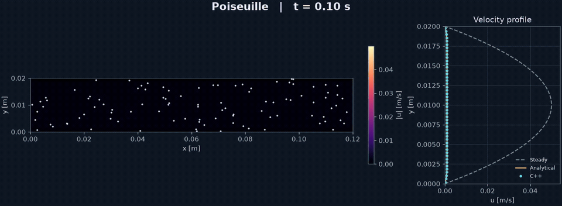
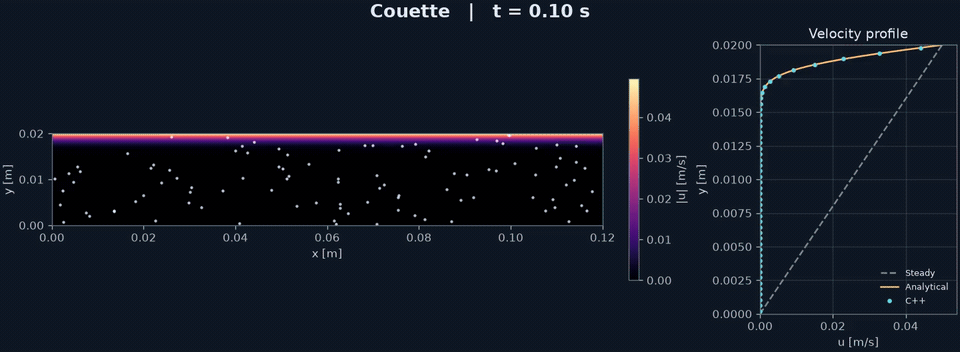
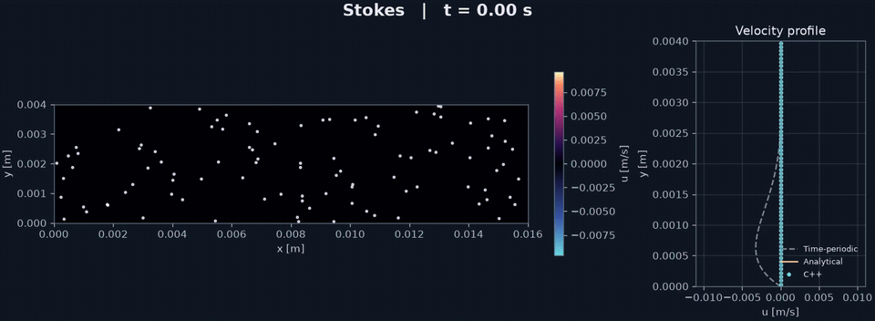
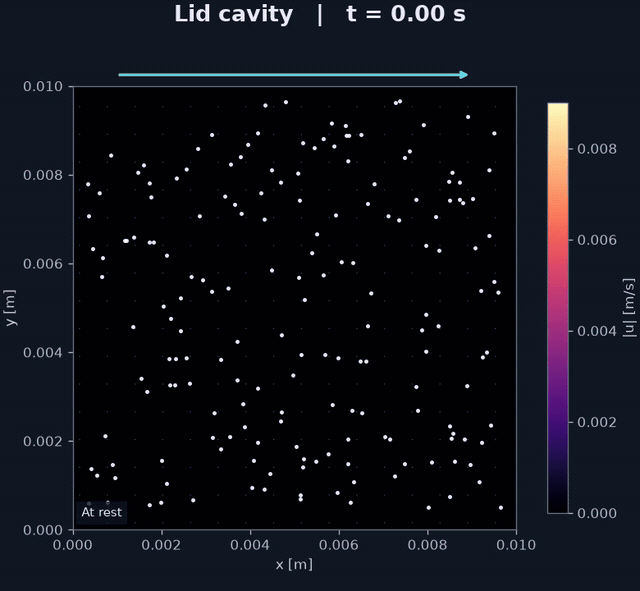
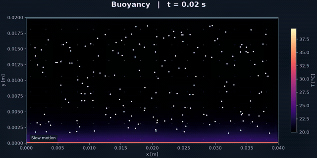
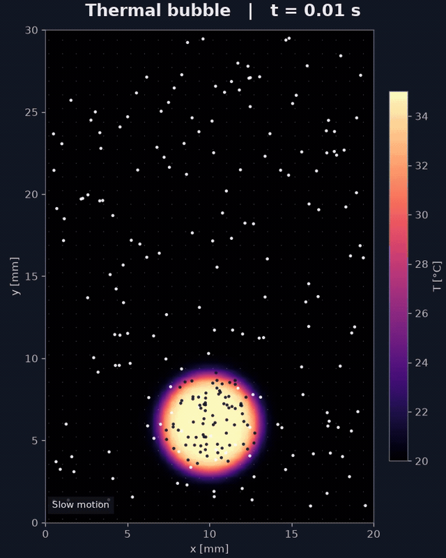

# Heat and flow in 2D

A small C++ solver for transient incompressible flow and heat transfer,
with Python for visualization.

Built for teaching: explicit loops, simple rectangular domains,
and tests against analytical solutions.

## Build and run

```sh
cmake -S . -B build -DCMAKE_BUILD_TYPE=Release
cmake --build build -j
ctest --test-dir build --output-on-failure
./build/simulate heated_wall results
python3 -m venv .venv
. .venv/bin/activate
python3 -m pip install -r requirements.txt
python3 visualize.py results --field T
python3 visualize.py results --field T --save results/temperature.png
```

[Cases](src/cases.hpp) · [Parameters](src/solver.hpp) · [Heat tests](tests/heat_equation_test.cpp) · [Fluid tests](tests/fluid_test.cpp)

## Method

We solve incompressible flow and temperature transport in a 2D rectangle,
with constant material properties.

**Momentum**

$$
\frac{\partial \mathbf{u}}{\partial t}
+(\mathbf{u}\cdot\nabla)\mathbf{u}
=-\frac{1}{\rho}\nabla p+\nu\nabla^2\mathbf{u}
+a_x\mathbf{e}_x+g\beta(T-T_{\mathrm{ref}})\mathbf{e}_y
$$

**Heat**

$$
\frac{\partial T}{\partial t}+\mathbf{u}\cdot\nabla T
=\alpha\nabla^2T
$$

Here $`\mathbf{u}=(u,v)`$ is velocity, $`t`$ time, $`p`$ pressure relative to the reference hydrostatic state, $`T`$ temperature, $`\rho`$ reference density, $`\nu`$ kinematic viscosity, and $`\alpha`$ thermal diffusivity. $`a_x`$ is an imposed horizontal acceleration (in Poiseuille, $`a_x=-(1/\rho)\,dp_{\mathrm{imposed}}/dx`$), $`g`$ the positive gravitational acceleration magnitude, $`\beta`$ the thermal expansion coefficient, and $`T_{\mathrm{ref}}`$ the reference temperature. $`\mathbf{e}_x=(1,0)`$ and $`\mathbf{e}_y=(0,1)`$ are unit vectors, with $`y`$ pointing upward; $`g\beta(T-T_{\mathrm{ref}})\mathbf{e}_y`$ is the Boussinesq buoyancy acceleration. $`\nabla`$ and $`\nabla^2`$ denote the gradient and Laplacian operators; incompressibility requires $`\nabla\cdot\mathbf{u}=0`$.

We use a uniform staggered grid: $p,T$ at cell centres, $u$ on vertical
faces and $v$ on horizontal faces. Advection uses first-order upwind
differences; diffusion uses second-order central differences.
Time integration is first-order explicit, with a sequential thermal/fluid update.

Each call to [Solver::step](src/solver.cpp) follows this order, skipping disabled equations:

1. Check the time step using the current velocity and active diffusivities.
2. Advance temperature using the current velocity.
3. Predict velocity from advection, viscosity and forces, using the updated
   temperature for buoyancy.
4. Solve the pressure Poisson equation and subtract the pressure gradient
   to enforce incompressibility. Reapply the wall conditions at the new time.

The pressure equation uses Gauss–Seidel, optionally with relaxation.
Pressure is determined up to a constant; one cell sets its reference.
Wall conditions use ghost cells; some channel cases use periodic boundaries in $x$.

The terminal shows Courant numbers, viscous/thermal Fourier numbers,
the combined explicit stability estimate and an estimated maximum time step.
The checks run every step; an excessive step or a nonfinite state stops the run.
These diagnostics use conservative velocity bounds including ghost cells.

## Transient heat conduction in water

Initially, the water is uniformly at 20°C. At t = 0 the left wall is set to
40°C; the right wall stays at 20°C. The top and bottom are insulated.
The 2 mm × 1 mm rectangle has no fluid motion or buoyancy: this isolates
thermal diffusion and gives a one-dimensional analytical solution.



12 s simulated in a 15 s video.
Colour shows temperature. Cyan points are the C++ solution, orange the analytical
transient, and dashed grey the steady linear profile.

```sh
./build/simulate heated_wall results_heated_wall
.venv/bin/python visualize.py results_heated_wall
.venv/bin/python visualize.py results_heated_wall --save results_heated_wall/heated_wall.gif
```

Water thermal diffusivity: 1.43e-7 m²/s. Mesh: 48 × 12, dt = 0.001 s.
[Transient test](tests/heated_wall_test.cpp): 0.1, 0.5, 1, 2, 5 and 12 s.
The maximum error must stay below 0.5% of the imposed 20 K temperature difference.
The original sinusoidal-decay and convergence tests remain in
[heat_equation_test.cpp](tests/heat_equation_test.cpp).

For the interior at t > 0, with initial temperature equal to the cold wall:

$$
T(x,t)=T_c+(T_h-T_c)\left(1-\frac{x}{L}\right)
-\frac{2(T_h-T_c)}{\pi}\sum_{n=1}^{\infty}
\frac{\sin(n\pi x/L)}{n}
\exp\left(-\frac{\alpha n^2\pi^2t}{L^2}\right)
$$

[Analytical method: heat equation with fixed end temperatures](https://www.math.purdue.edu/~pvankoug/math303/hw9solns.pdf)

## Poiseuille

The fluid starts at rest. A constant pressure gradient accelerates it, while viscosity
slows it down near the stationary walls. The velocity profile gradually approaches
the steady parabola.



30 s simulated, played at 2.5x speed.
White particles follow the numerical velocity; cyan points show the numerical
profile, orange the transient analytical solution, and dashed grey the steady limit.

```sh
cmake --build build -j
ctest --test-dir build --output-on-failure
./build/simulate poiseuille results_poiseuille
.venv/bin/python visualize.py results_poiseuille
.venv/bin/python visualize.py results_poiseuille --save results_poiseuille/poiseuille.gif
```

Start from rest. Evolve for 30 s. Save every 0.1 s. Playback: 25 fps (2.5x physical speed).
Periodic left/right; stationary walls at bottom/top.
Constant acceleration: `a = -(dp/dx)/rho`. Output `p`: periodic pressure component.

[Poiseuille tests](tests/poiseuille_test.cpp): 0.1, 0.5, 2, 5, 8, 15, 30 s.
The final-profile test requires a maximum error below 0.2% of the steady
centerline velocity. With the default case:

| Physical time | Maximum difference from the steady parabola |
| --- | --- |
| 8 s | 14.30% |
| 30 s | 0.041% |

Differences are normalized by the theoretical steady centerline velocity.
These checks validate viscous diffusion, the channel boundaries, and the transient
profile. General two-dimensional nonlinear advection needs a separate benchmark.

$$
u(y,t)=\frac{a}{2\nu}y(H-y)
-\frac{4aH^2}{\nu\pi^3}
\sum_{n=1,3,5,\ldots}
\frac{\sin(n\pi y/H)}{n^3}
\exp\left(-\frac{\nu n^2\pi^2t}{H^2}\right)
$$

[Analytical reference: MIT](https://web.mit.edu/course/10/10.34/www/ch4_Poiseuille_startup.htm)

## Couette

The fluid starts at rest. The top wall suddenly moves at 0.05 m/s while the
bottom wall stays fixed. Viscosity transfers momentum into the channel until
the velocity profile approaches a straight line.



30 s simulated, played at 2.5x speed.
White particles follow the numerical velocity; cyan points show the numerical
profile, orange the transient analytical solution, and dashed grey the steady limit.

```sh
./build/simulate couette results_couette
.venv/bin/python visualize.py results_couette
.venv/bin/python visualize.py results_couette --save results_couette/couette.gif
```

Periodic left/right; fixed bottom wall; moving top wall. No imposed pressure gradient.
Start from rest. Evolve for 30 s. Save every 0.1 s.

[Couette tests](tests/couette_test.cpp): 0.1, 0.5, 2, 5, 8, 15, 30 s.
Transient error must stay below 0.5% of wall speed; the final-profile test requires
an error below 0.2% of wall speed. With the default case:

| Physical time | Maximum difference from the steady line |
| --- | --- |
| 8 s | 8.85% |
| 30 s | 0.039% |

Differences are normalized by the moving wall speed. These checks validate
momentum diffusion from a moving wall and the transient approach to linear shear.

$$
u(y,t)=U\frac{y}{H}
+\frac{2U}{\pi}\sum_{n=1}^{\infty}
\frac{(-1)^n}{n}\sin\left(\frac{n\pi y}{H}\right)
\exp\left(-\frac{\nu n^2\pi^2t}{H^2}\right)
$$

[Analytical reference: transient Couette flow](https://web.mit.edu/calculix_v2.7/CalculiX/ccx_2.7/doc/ccx/node15.html)

## Stokes: oscillating wall in water

Water starts at rest. The bottom wall oscillates horizontally:
u_wall(t) = U sin(omega t), with U = 0.01 m/s and period 2 s.
The top wall stays fixed and left/right boundaries are periodic.
Temperature and buoyancy are disabled.



Four cycles: 8 s of physical time shown in a 20 s animation.
The fluid is nearly black at rest. Warm tones show rightward velocity;
blue and cyan show leftward velocity. The moving particles reverse
direction; the cyan profile is numerical, orange is the analytical startup,
and dashed grey is the long-time periodic solution.

```sh
./build/simulate stokes results_stokes
.venv/bin/python visualize.py results_stokes
.venv/bin/python visualize.py results_stokes --save results_stokes/stokes.gif
```

Water: density 998.2 kg/m³, kinematic viscosity 1.004e-6 m²/s.
Domain: 16 mm × 4 mm; mesh 24 × 64; dt = 0.0005 s.
This is the finite-channel version of Stokes' second problem; the analytical
comparison includes the stationary upper wall and the initial transient.

[Stokes tests](tests/stokes_test.cpp) check startup, reversal, incompressibility
and wall velocity at 0.1, 0.5, 1, 1.5, 2, 3.5, 5, 7.5 and 8 s.
Maximum startup error: below 0.5% of wall amplitude.
At 8 s the profile must also be within 0.3% of the periodic solution.

With k_n = n pi/H and lambda_n = nu k_n²:

$$
u(y,t)=U\left(1-\frac{y}{H}\right)\sin(\omega t)
-\frac{2U\omega}{\pi}\sum_{n=1}^{\infty}
\frac{\sin(k_n y)}{n}
\frac{\lambda_n\cos(\omega t)+\omega\sin(\omega t)-\lambda_n e^{-\lambda_n t}}
{\lambda_n^2+\omega^2}
$$

[Background: Stokes' second problem and oscillatory Couette flow](https://arxiv.org/abs/2107.12894)

## Examples

Cases are defined explicitly in [src/cases.hpp](src/cases.hpp).
Choose a case with the first argument and a new output directory with the second.
Edit its dimensions, mesh, time step, duration and four walls to try another setup.

### Lid-driven cavity: water, no temperature

A 1 cm square cavity starts at rest. The top wall moves to the right at
0.01004 m/s; the other three walls stay fixed. Water properties:
density 998.2 kg/m³, kinematic viscosity 1.004e-6 m²/s. Reynolds number: 100.
Temperature and buoyancy are disabled.



Starts at rest; first 5 s at real speed, then 5x.
The colour shows speed; moving white particles reveal circulation.
Faint arrows show velocity direction and magnitude.
The cyan arrow indicates the motion of the lid.

```sh
cmake --build build -j
./build/simulate lid_cavity results_lid_cavity
.venv/bin/python visualize.py results_lid_cavity
.venv/bin/python visualize.py results_lid_cavity --save results_lid_cavity/lid_cavity.gif
```

32 × 32 cells, dt = 0.005 s, 8000 steps, one snapshot every 0.2 s.
This is a simulation example; no cavity benchmark validation is claimed.

### Buoyancy: air heated from below

A 4 cm × 2 cm rectangle starts at rest near 20°C. The bottom wall is held
at 40°C and the top wall at 20°C; the side walls are insulated. All four
walls are stationary and impermeable. Temperature and velocity evolve together
with the Boussinesq buoyancy force.



0–8 s of physical time, slowed down to a 15 s video.
Colours show temperature in °C; particles and arrows show the motion of the air.

```sh
cmake --build build -j
./build/simulate buoyancy results_buoyancy_demo
.venv/bin/python visualize.py results_buoyancy_demo
.venv/bin/python visualize.py results_buoyancy_demo --save results_buoyancy_demo/buoyancy.gif
.venv/bin/python visualize.py results_buoyancy_demo --field speed
```

32 × 16 cells, dt = 0.002 s, 4000 steps: 8 s simulated, one snapshot every 0.1 s.
Air: density 1.204 kg/m³, kinematic viscosity 1.516e-5 m²/s,
thermal diffusivity 2.14e-5 m²/s and expansion coefficient 3.43e-3 K⁻¹.
The initial temperature contains a deterministic 0.02 K sinusoidal perturbation
to break horizontal symmetry and seed convection; initial velocities are zero.
This is a qualitative example on a small grid.

[Background: natural convection in air](https://www.comsol.com/blogs/simulating-natural-convection-in-air)

### Rising thermal bubble: warm water in cold water

A circular patch of water near 35°C starts near the bottom of water at 20°C.
The entire domain starts at rest. Buoyancy makes the warm water rise and spread,
while the surrounding water recirculates. This is a temperature anomaly within
a single liquid, without a free surface, air bubble or surface tension.



4 s of physical time shown in a 15 s animation. Colour shows temperature in °C.
Dark particles mark water that was initially hot; white particles show the
surrounding circulation. All four walls are stationary, impermeable and insulated.

```sh
cmake --build build -j
./build/simulate thermal_bubble results_thermal_bubble_demo
.venv/bin/python visualize.py results_thermal_bubble_demo
.venv/bin/python visualize.py results_thermal_bubble_demo --save results_thermal_bubble_demo/thermal_bubble.gif
```

Domain: 20 mm × 30 mm. Initial patch: centre (10 mm, 6 mm), radius 3 mm,
with a smooth temperature transition at its edge.
Water: density 998.2 kg/m³, kinematic viscosity 1.004e-6 m²/s,
thermal diffusivity 1.43e-7 m²/s and expansion coefficient 2.07e-4 K⁻¹.
Mesh: 48 × 72; dt = 0.002 s; 2000 steps; snapshots every 0.04 s.
Pressure uses relaxation 1.7 to reduce iteration cost.
This is a qualitative convection example.
